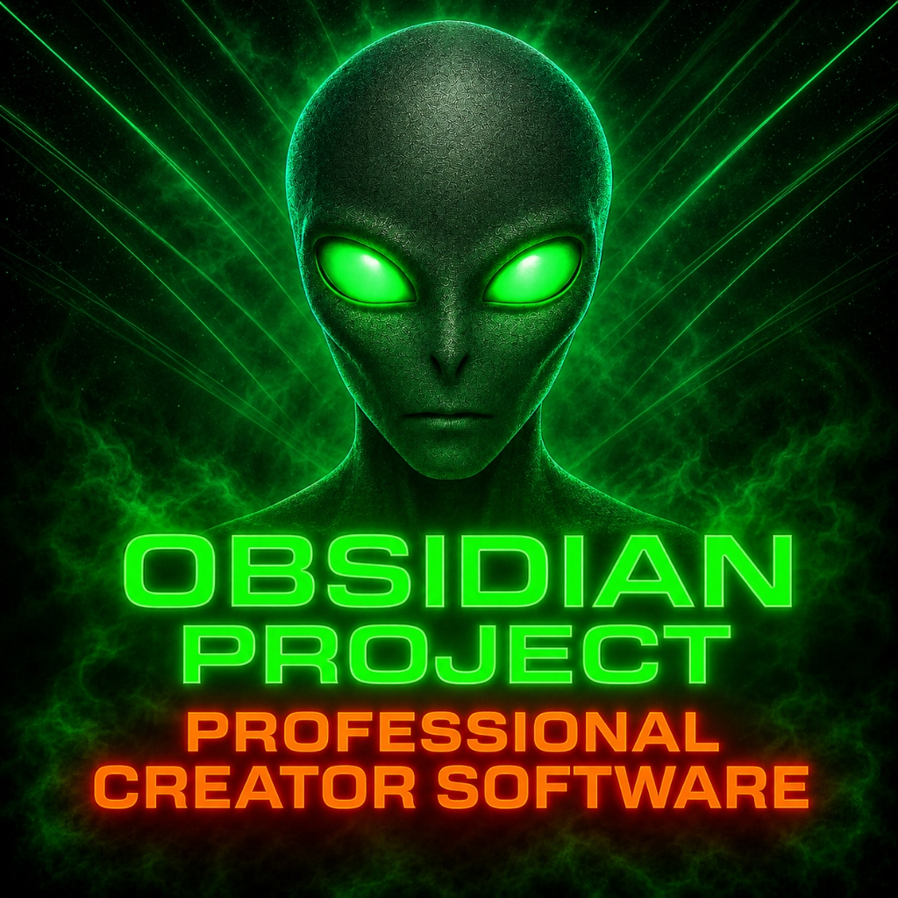
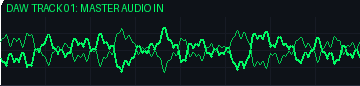
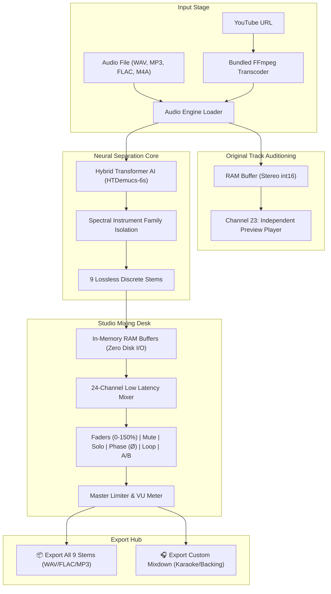

<div align="center">

  

  # 🎛️ OBSIDIAN STEM SPLITTER PRO
  ### Professional AI-Powered Multi-Track Audio Separation Studio & Mixing Desk

  [-0078D6?style=for-the-badge&logo=windows&logoColor=white)](https://github.com/PaulMagennis/Obsidian-Stem-Splitter-Pro)
  [](https://www.python.org/)
  [](https://pytorch.org/)
  [](LICENSE)
  [](https://github.com/PaulMagennis/Obsidian-Stem-Splitter-Pro/releases)

  <p align="center">
    <b>Separate any audio track into 9 discrete studio instrument stems with zero phase cancellation, real-time in-memory mixing, and 100% offline local privacy.</b>
  </p>

  

</div>

---

## 🌟 Overview

**Obsidian Stem Splitter Pro** is a high-performance desktop digital audio workstation designed for music producers, remixers, sound designers, DJs, and audio engineers. Powered by state-of-the-art hybrid Demucs transformer neural networks, it splits complex audio recordings into **9 distinct, isolated instrument stems** while providing a low-latency 9-channel hardware-accelerated mixing console.

Unlike cloud-based stem services that compromise your audio quality with lossy compression and privacy risks, Obsidian runs **100% locally on your machine with zero cloud uploads**, offering pristine lossless exports and instantaneous RAM-cached auditioning.

---

## 🎯 Target Instrument Stems (9 Separate Tracks)

| Stem | Icon | Frequency & Sound Isolation Range |
| :--- | :---: | :--- |
| **Vocals** | 🎤 | Lead vocal lines, harmonies, ad-libs, and spoken word |
| **Drums** | 🥁 | Full drum kit (kick, snare, hi-hats, cymbals, toms, 808 percussion) |
| **Bass** | 🎸 | Bass guitar, synth bass, sub-bass frequencies, and 808 glides |
| **Guitar** | 🎸 | Electric guitars (lead/rhythm), acoustic guitars, clean picking |
| **Keyboard & Synth** | 🎹 | Acoustic pianos, Rhodes, electric organs, polyphonic synth chords |
| **Brass** | 🎺 | Trumpets, trombones, French horns, tubas, big band horn sections |
| **Woodwind** | 🎷 | Saxophones (alto/tenor/soprano), flutes, clarinets, oboes, reeds |
| **Stringed Instruments** | 🎻 | Violins, violas, cellos, double basses, orchestral string ensembles |
| **Other / Ambience** | ✨ | FX risers, background noise, environmental textures, synth pads |

---

## 🚀 Key Features

### 🎚️ Synchronous Studio Mixing Console
- **Direct RAM Audio Buffering**: Zero disk I/O during playback. Audio channels stream synchronously with $<5\text{ms}$ seek response.
- **Dynamic VU Meters**: Real-time RMS volume meters for all 9 stem strips and the master bus.
- **Individual Faders (0% to 150%)**: Boost quiet background stems or attenuate dominant lead channels.
- **Direct Percentage Input & 100% Reset**: Click in to manually type exact volume percentages (e.g. `85%`) or click `100%` for instant reset.
- **Multi-Track Selection**: Hold `Shift` or `Ctrl` to select multiple stems at once and adjust or mute/solo them in tandem.

### 🎧 Pro Audio & Production Tools
- **Instant A/B Test (`🎧 A/B Test`)**: Seamlessly toggle between listening to the **Original Track** and the active **9-Stem Mix** at the exact same playhead timestamp.
- **Phase Inversion (`Ø Phase Flip`)**: Toggle 180° polarity reversal on any stem in real time to isolate frequencies, check phase cancellation, or craft karaoke subtractive tracks.
- **Master Peak Limiter & CLIP Alert**: Built-in master bus protection with a glowing red `CLIP` badge that triggers whenever summed levels approach digital clipping ($\ge 0.99$).
- **Seamless Section Looping (`🔁 Loop`)**: Loop specific sections or entire tracks continuously while fine-tuning channel faders.
- **Smart Spacebar Routing**: Intelligent DAW transport control—taps play/pause on the original preview track before separation, and on the 9-stem mixer after separation.

### 🎵 Dedicated Drag & Drop Preview Player
- Test and audition original tracks directly inside the drag-and-drop zone **before separating anything**.
- Includes dedicated Play, Pause, Stop, Timeline Scrubber, Volume Slider, Mute, and `100%` Reset.
- Built-in `✕ Unload` button to clear audio memory and reset the workspace to a pristine state.

### 📺 Integrated YouTube Audio Importer
- Import audio directly by pasting any YouTube video or music link.
- Automatically selects the first track from playlists and transcodes streams directly into high-fidelity studio WAV via bundled FFmpeg.

### 📦 Multi-Format Studio Export Hub
- **Formats**: WAV (24-bit Lossless Studio / 16-bit CD Quality), FLAC (Lossless), MP3 (320 kbps CBR).
- **Export All 9 Stems**: Automatically saves all isolated stems into a organized folder and opens Windows Explorer upon completion.
- **Export Custom Mixdown**: Renders your custom mixer balance (incorporating volume faders, mute, solo, phase flip, and master gain) into a single stereo master file.

---

## ⌨️ Studio Keyboard Shortcuts

| Shortcut | Action | Description |
| :---: | :--- | :--- |
| <kbd>Spacebar</kbd> | **Smart Play / Pause** | Toggles preview player before separation; toggles 9-stem mixer after separation |
| <kbd>M</kbd> | **Mute / Unmute** | Mutes or unmutes all currently selected stems simultaneously |
| <kbd>S</kbd> | **Solo / Unsolo** | Solos or unsolos all currently selected stems simultaneously |
| <kbd>P</kbd> | **Phase Invert (Ø)** | Flips 180° phase polarity on selected stems |
| <kbd>Ctrl</kbd> + <kbd>A</kbd> | **Select All Stems** | Selects all 9 mixing strips for bulk adjustments |
| <kbd>Esc</kbd> | **Clear Selection** | Deselects all active stem highlights |

---

## 🏗️ System Architecture



---

## 💻 Installation & Usage

### Option 1: Standard Windows Installer (Recommended)
Download and run the installer setup executable:
- **File**: `Obsidian_Stem_Splitter_Pro_Setup.exe`
- **Features**: Includes desktop icons, Start Menu shortcuts, Windows Explorer right-click context menu (*"Separate Stems with Obsidian Stem Splitter Pro"*), and pre-cached offline AI model weights.

### Option 2: Portable Standalone Executable
- **File**: `ObsidianStemSplitterPro.exe`
- Run immediately without installation. Fully self-contained with bundled FFmpeg and PyTorch runtimes.

### Option 3: Run from Source (Developers)
Clone the repository and install the Python dependencies:

```powershell
# 1. Clone repository
git clone https://github.com/PaulMagennis/Obsidian-Stem-Splitter-Pro.git
cd Obsidian-Stem-Splitter-Pro

# 2. Create virtual environment (Python 3.12 recommended)
python -m venv venv
.\venv\Scripts\activate

# 3. Install dependencies
pip install -r requirements.txt

# 4. Launch Obsidian Stem Splitter Pro
python obsidian_stem_splitter_pro.py
```

---

## ⚡ System Requirements

| Component | Minimum | Recommended |
| :--- | :--- | :--- |
| **Operating System** | Windows 10 (64-bit) | Windows 11 (64-bit) |
| **Processor (CPU)** | Intel Core i5 / AMD Ryzen 5 (4+ Cores) | Intel Core i7 / AMD Ryzen 7+ (8+ Cores) |
| **Memory (RAM)** | 8 GB RAM | 16 GB - 32 GB RAM |
| **GPU Acceleration** | CPU Fallback (Multi-threaded) | NVIDIA RTX / GTX Series with CUDA support (4GB+ VRAM) |
| **Storage** | 2 GB available disk space | SSD with 5 GB+ available disk space |

---

## 📄 License

This project is licensed under the **MIT License** - see the [LICENSE](LICENSE) file for complete details.

---

<div align="center">
  <b>Developed by Paul Magennis &bull; Obsidian Project</b><br/>
  <sub>Professional Creator Software &bull; Audio AI Engineering</sub>
</div>
